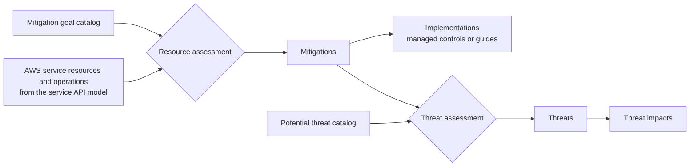

# Threat Models for AWS Services

Copyright Amazon.com, Inc. or its affiliates. All Rights Reserved.  SPDX-License-Identifier: CC-BY-4.0

The content in this repository is generated from other sources. For this reason, we are unable to accept pull requests. Issues or feedback related to service threat models should be directed through the channels described in CONTRIBUTING.md.

## DISCLAIMER

These threat models are designed to help customers strengthen their security and governance posture under the [AWS Shared Responsibility Model](https://aws.amazon.com/compliance/shared-responsibility-model/). They identify common security and governance risks related to how AWS services are configured and operated - such as overly permissive access policies, misconfigured resources, and disabled logging or monitoring - and are not indicative of vulnerabilities in AWS services themselves.

Use these threat models as a starting point to accelerate your security and governance analysis, prioritize efforts, and identify relevant controls. Because every environment is different, we recommend tailoring the models to your specific use case and supplementing them with additional threats and controls as appropriate.

## Introduction

This repository contains threat models for AWS services, published by AWS, to help customers accelerate service review processes and implement security and governance controls in their environments. Each threat model identifies potential threats related to misconfigurations within the customer's area of responsibility under the [AWS Shared Responsibility Model](https://aws.amazon.com/compliance/shared-responsibility-model/), categorized against [MITRE ATT&CK](https://attack.mitre.org/), where applicable, for consistent classification and alignment with industry-standard security frameworks. Each threat is mapped to mitigations and control implementations that help address it.

The threat models address both security and governance objectives - including data protection, resilience, availability, operational governance, and privacy - which this documentation sometimes refers to collectively as "security" for brevity. As a result, some threats address governance and operational considerations that fall outside an adversarial security model, and not every threat maps to a corresponding [MITRE ATT&CK](https://attack.mitre.org/) technique.

The following is a simplified representation of a threat, related mitigation, and control implementations from the AWS Lambda service threat model.

| **Threat** | Source: An IAM principal Prerequisites: with IAM permissions to create, modify, or invoke an AWS Lambda function Threat Action: can use the function to send and receive traffic on an ungoverned network |
| --- | --- |
| **Mitigation** | An AWS Lambda function should be in an Amazon VPC |
| **Implementation (Preventive)** | Service control policy (SCP) guidance with the `lambda:VpcIds` condition key to restrict creation of functions to a VPC you manage |
| **Implementation (Proactive)** | CloudFormation Hooks guidance monitoring the [VpcConfig](https://docs.aws.amazon.com/AWSCloudFormation/latest/UserGuide/aws-resource-lambda-function.html) property of the [AWS::Lambda::Function](https://docs.aws.amazon.com/AWSCloudFormation/latest/UserGuide/aws-resource-lambda-function.html) resource to prevent deployment of misconfigured functions |
| **Implementation (Detective)** | AWS Config rule guidance assessing the `vpcConfig.subnetIds` configuration parameter to detect misconfigurations that are already in place |

The threat models are designed to supplement your assessment of an AWS service before you approve it for use in your organization. They also help you research how AWS services relate to common security and governance objectives and find controls and processes to address those objectives.

## Definitions

**Threat** - An accidental, mistaken, or intentional event that may have unwanted impacts on the security of a system. Threats to assets create security risk, which is equal to the likelihood of a threat occurring multiplied by its impact.

**Mitigation** - A method to reduce the risk posed by a threat. Each mitigation is a configuration of an AWS service resource that addresses one of the common security and governance objectives. It is not a prescriptive recommendation to enable a particular configuration; it describes a security and governance configuration available for a resource should you choose to use it, allowing you to determine whether it is appropriate for your environment.

**Implementation** - A rule implemented in a control mechanism to achieve mitigations and provide ongoing governance for a system. There are four implementation behaviors: preventive (blocks unintended actions), proactive (prevents misconfigured resources from being provisioned), detective (detects misconfigured resources or unintended actions), or directive (policy or process).

## Scope of the threat models

The threat models in this repository are bounded by a defined set of mitigation goals and potential threats, defined as follows:

**Mitigation goal** - A common security and governance control objective that customers want to achieve consistently across AWS services, such as restricting public access, enforcing encryption, enabling logging, or limiting cross-account access.

- Example: "Deploy resources within a VPC when VPC deployment is optional."

**Potential threat** - A service-agnostic, high-level statement describing a class of threat that can materialize when a specific set of conditions is present in a service resource's configuration.

- Example: "AWS resources with network communication capabilities that are deployed without VPC attachment can send and receive traffic on ungoverned networks, without the security controls such as firewalls and traffic inspection that a VPC configuration would enforce."

You can find the mitigation goals and potential threats within the scope of the threat models in Markdown and machine-readable JSON format in `threat-models-for-aws-services/reports/` and `threat-models-for-aws-services/data/` respectively.

AWS service resources are assessed against mitigation goals to produce a set of mitigations applicable to the service.  This assessment is scoped to AWS service APIs and their request parameters. If a mitigation goal cannot be achieved through an AWS service API for a given resource, it is not surfaced as a mitigation in a threat model. For each mitigation, an assessment is performed to validate applicability and feasibility of control implementation behaviors and to produce a set of implementations that can be used to achieve it. Implementations either reference a managed control from the [AWS Control Catalog](https://docs.aws.amazon.com/controlcatalog/latest/userguide/what-is-controlcatalog.html) or provide an implementation guide containing the details needed to build the control yourself.

Each identified mitigation is assessed against potential threats that can materialize if it is not implemented, producing a set of threats applicable to the service. Each threat is mapped to the applicable threat impact to help prioritize control implementation based on your security and governance objectives.

Implementations may not fully address the impact of the threats associated with them through mapped mitigations. Additional implementations and processes may be required to eliminate the potential risk of a given threat, and the proposed mitigations and implementations may not be the only ways to address it.

For a detailed threat model structure with information about the data surfaced in each component, see [docs/design.md](docs/design.md).

Each threat model covers a single AWS service and the resource types you create and configure through its APIs. Mitigations that belong to a separate, integrated service are addressed in that service's own threat model - for example, mitigations for an Amazon EBS volume used by an Amazon EKS cluster are covered in the Amazon EBS threat model, not in the Amazon EKS model.

As services evolve and update their [service models](https://github.com/aws/api-models-aws), the list of applicable mitigations and threats may change. Refer to the `serviceModelUrl` value in each threat model for the specific service model version used, and to the `version` value in [threat-models-for-aws-services/manifest.json](threat-models-for-aws-services/manifest.json) to identify what changed between publications. Every release of the threat models is tagged with that version prefixed by `v` (for example `v1.0.0`), so a specific release can be checked out, downloaded as an archive, or referenced by tag; commits that change only this repository's documentation or automation are not releases and carry no tag. You can also use the scope increase request issue template to request that additional mitigation goals or potential threats be brought into scope.

There are categories of threats that fall outside the scope of these models entirely. Workload-specific threats - such as application-level vulnerabilities, business logic flaws, or threats arising from customer code running on AWS (e.g., insecure dependencies in a container image running on Amazon EKS or injection vulnerabilities in application logic running on Amazon EC2 instances) - are not included. Similarly, common infrastructure security tasks, including restricting network egress to trusted domains and placing a WAF in front of web applications, are not fully covered. For guidance on these topics, refer to the Infrastructure Protection and Application Security sections of the [Security Pillar - AWS Well-Architected Framework](https://docs.aws.amazon.com/wellarchitected/latest/security-pillar/welcome.html).

We encourage you to review the identified threats and mitigations in the context of your organization's specific business needs, data sensitivity, compliance requirements, and risk tolerance. You may determine that additional controls are appropriate for your environment, and we recommend validating your configuration through methods such as integration testing.

## Repository structure

This repository contains the following top-level directories:

- [docs/](docs/) - Design documents covering the threat model structure with information on the types of data surfaced in each component. Kept in the repository only; the source archives GitHub serves for a tag (`archive/refs/tags/<tag>.zip`) contain the `threat-models-for-aws-services/` directory, this README and the LICENSE.
- [threat-models-for-aws-services/](threat-models-for-aws-services/)
  - [README.md](threat-models-for-aws-services/README.md) - The index of this release: its version, the layout of the folder, and a per-service summary with links to the reports.
  - [manifest.json](threat-models-for-aws-services/manifest.json) - The machine-readable index of the release: its version, and the path and SHA-256 digest of every data, schema and report file - the manifest's own schema, each catalog's data, schema and report, and each service threat model's data and report (`services`) - so a file fetched on its own can be verified.
  - [reports/](threat-models-for-aws-services/reports/) - The catalog of potential threats, mitigation goals, and threat impacts within the scope of the threat models, as well as individual service threat models, in Markdown format.
  - [data/](threat-models-for-aws-services/data/) - The catalog of potential threats, mitigation goals, and threat impacts within the scope of the threat models, as well as individual service threat models, in JSON format.
  - [schema/](threat-models-for-aws-services/schema/) - JSON Schema for the manifest, for potential threats, mitigation goals, and threat impacts, and for a service threat model.

The Markdown versions present a subset of the data available in the corresponding JSON files, optimized for readability. For the complete dataset, use the JSON version.

## Getting started

New to these threat models? Walk through a single service end to end before applying the process broadly. This example uses AWS Lambda to show how to go from a threat model to a deployed control.

1. **Open the Lambda threat model -** Go to `threat-models-for-aws-services/reports/services/lambda.md` for the human-readable version (or `threat-models-for-aws-services/data/services/lambda.json` for the machine-readable data). Skim the metadata and the list of threats and mitigations to understand the security and governance objectives applicable to the service within the current scope of the threat models.
2. **Pick one threat to follow -** For example, a threat describing a Lambda function deployed without VPC attachment, which can send and receive traffic on ungoverned networks - outside the reach of your network security controls. Read its source, prerequisites, threatAction, and requestParameters to understand exactly what must be true for the threat to be realized, and check the threat impacts it maps to.
3. **Trace it to a mitigation -** Follow the threat mapping to its mitigation - "An AWS Lambda function should be in an Amazon VPC." Note the configuration parameters that apply the mitigation (`$.VpcConfig`) and the verification parameters that confirm it's in place.
4. **Review the mapped implementations -** Look at the control implementations linked to that mitigation across behaviors - for instance, a *preventive* SCP that uses the `lambda:VpcIds` condition key to deny function creation without a VPC configuration, a *detective* AWS Config rule that flags functions with no `$.VpcConfig`, and a *proactive* CloudFormation hook that validates that `$.VpcConfig` is set at resource creation. Decide which behaviors fit how you operate.
5. **Assess relevance to your environment -** Ask whether this threat and mitigation apply to your use of Lambda, given your data sensitivity, compliance requirements, and risk tolerance. If they do, note the control you'll implement; if not, record why it's out of scope for you.
6. **Build and validate one control -** Using the implementation guidance, build the control in a non-production environment, confirm it behaves as expected without disrupting legitimate workloads, then roll it out progressively.

## Next steps

Apply the process across services and keep your assessment current:

1. **Understand the scope** - Review `threat-models-for-aws-services/reports/` or `threat-models-for-aws-services/data/` to understand which potential threats, mitigation goals, and impacts are covered. Identify what remains outside of scope for your own assessment. Complement threat models with your own application-level and workload-specific threat assessments.
2. **Identify relevant threats and mitigations** - Review the threat model for your service in `threat-models-for-aws-services/reports/services/` or `threat-models-for-aws-services/data/services/`. Evaluate the likelihood and impact of each threat based on your threat context to understand the risk it creates and select an appropriate risk mitigation strategy. Review the applicability of mapped mitigations and assess whether additional mitigations are needed based on your specific security and governance requirements and environment context.
3. **Select appropriate controls** - For each applicable mitigation, review the proposed control implementations and select those that align with your risk mitigation strategy.
4. **Build selected controls** - Build controls following the implementation guidance and your preferred control implementation mechanism.
5. **Deploy and validate controls** - Validate that implemented controls are functioning as expected through integration testing and continuous monitoring.
6. **Re-evaluate periodically** - Re-assess applicable threats and mitigations periodically, especially after adopting new service features or changing your architecture and requirements. Subscribe to GitHub notifications for Releases to see published changes to the threat models and determine whether any updates affect your environment and require additional action.

## License Summary

Content in this repository is made available under the CC-BY-4.0 International License. See the LICENSE file.

